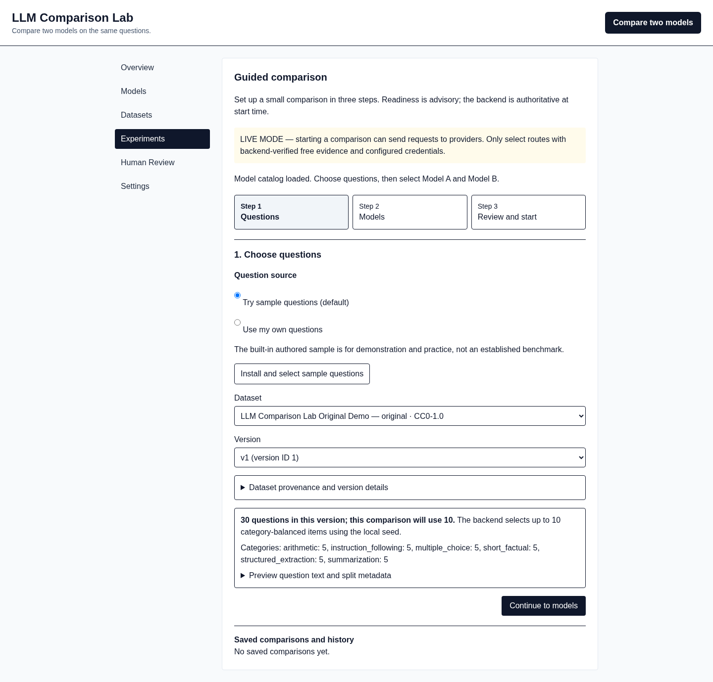
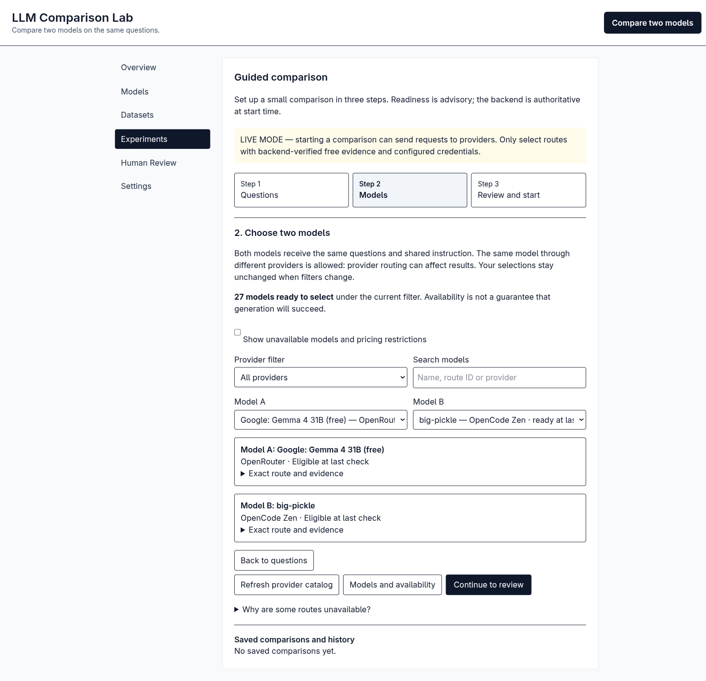
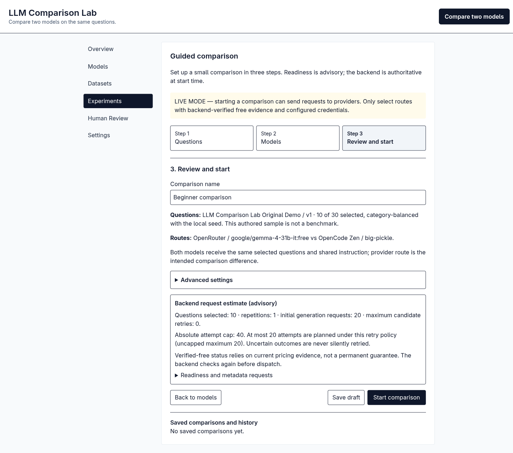
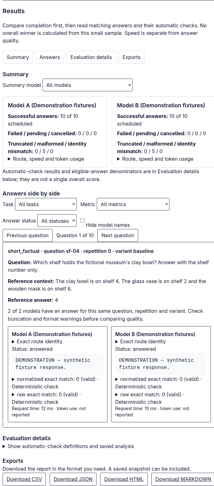
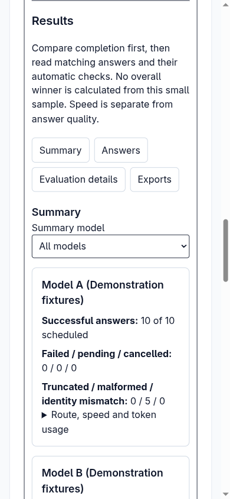

# LLM Comparison Lab — teaching and presentation notes

**Audience:** teammates, presenters, and an AI tutor reading this repository.

**Scope:** the **current React + FastAPI app** under `frontend/` and `backend/`, not the preserved root Flask/CLI prototype.
**How to use these notes:** read the brief first; then walk through the screenshots and the deeper explanations. Use the [slide-making prompt](PRESENTATION_PROMPT.md) if creating a PowerPoint. Screenshots from a live-mode *setup* and screenshots from a synthetic *results example* are deliberately kept distinct. No new real model-generation run was performed for this guide.

> **For an AI tutor:** Teach this in layers. Start with the brief, ask the learner to explain “same questions, two exact routes, separate evidence,” and only then explain datasets, job attempts, scorers and research attribution. Use the worked example and screenshots. Ask the learner to distinguish *a route shown as selectable*, *a completed provider response*, *a correct response under a declared check*, and *evidence of general model quality*. Do not turn any demonstration screenshot into a claim about a real model. Stop and say “not established” when the repository cannot support a claim.

**Copy/paste to your teaching AI after sharing this folder:**

> Read `docs/TEAM_PRESENTATION_NOTES.md` and the linked screenshots in `/home/fadhil/Projects/llm-comparison-beginner`. First explain Part 1 simply as if I am new to LLM evaluation. Then teach Part 2 screenshot by screenshot, saying which images are live setup and which are synthetic results. Then teach Part 3 in small chunks with concrete examples. After each chunk, ask me one question and wait for my answer before continuing; correct misconceptions kindly and cite a file or paper link for important claims. Help me rehearse Part 4 as a presentation to teammates, then quiz me on what the app implements versus what the research papers only inspired. Never claim we ran HELM, official IFEval, MT-Bench, Chatbot Arena, or an AI judge; never invent live model scores or initiate paid/provider requests. If the repo has changed since these notes, inspect the code and point out any differences.

## Part 1 — brief explanation (the two-minute version)

**What is this?** A local app for making a small, inspectable comparison between **two provider/model routes**. We choose one version of a question set, choose Model A and Model B, and review the number of planned requests. When a user deliberately starts a live run, the backend checks that the exact routes and current price evidence satisfy its **free-only policy**. A durable worker sends the same selected questions and shared instruction to both routes, saves each attempt and response, and shows progress. Results put both answers to the *same question* side by side; failures, missing answers and timings remain visible. Automatic checks are narrow, task-specific tests—not an overall intelligence score.

**Where research fits:** Our primary reference is [Chang et al., *A Survey on Evaluation of Large Language Models* (2024)](https://doi.org/10.1145/3641289), which organizes evaluation into **what** to test, **where** to test it, and **how** to assess it. Our app implements a *limited local interpretation* of those questions: a few authored task types, versioned datasets, shared run settings, specific checks, transparent missingness, and optional human review. We did **not** implement the whole survey or its many benchmarks. HELM, IFEval, statistical-testing research and MT-Bench/Chatbot Arena informed bounded ideas, **not** replicated benchmark results.

**What can we claim?** The software workflow and mocked/fixture tests work. The previous small, separate OpenRouter live smoke recorded 20/20 responses on 10 convenience-sampled items; it is **not a broad performance study**. The newer live setup screenshots show selectable routes and a budget **before** Start, not authenticated generation. The results screenshots below show **synthetic fixtures**, not actual OpenRouter or Zen answers. Never announce an overall winner from either screenshot.

**One line to say aloud:** “We turned a survey's evaluation questions into a reproducible local workflow that shows what was asked, who received it, what came back, what failed, and what our narrow metrics can—and cannot—say.”

### The flow in one picture

```text
Versioned questions ──┐
                      ├─> Review same inputs + 2 exact routes + request budget
Model A + Model B ────┘                           │
                                                 ▼ (only after user clicks Start)
                          Freeze design → durable jobs → provider requests
                                                   │
                          Saved attempts/errors/answers + task-specific checks
                                                   │
                         Coverage → paired answers → human review / exports
```

**Start is a consequential action.** A displayed estimate or catalog entry never sends generation requests. The user must start a comparison. Having an API key configured or a model listed does not prove its generation endpoint will accept a request.

### Ten terms you should be able to explain

| Term | Beginner meaning |
| --- | --- |
| **Model route** | The exact provider + model ID + supported endpoint used for a request; not only a public model name. |
| **Catalog** | The provider's current list of offered routes and metadata; a listing is not a successful generation. |
| **Price evidence** | Dated proof that a route's required price fields satisfy the app's free-only rule; it can expire. |
| **Dataset version / provenance** | The saved exact question set and its origin/license/split details, identified by a content hash. |
| **Item / family** | One question / a related base question and variants, which may form one independent analysis unit. |
| **Job / attempt / answer** | One planned model×question×repetition task / an effort to execute it / a saved response if one arrives. |
| **Coverage** | How many scheduled requests produced usable responses versus failed, pending or cancelled work. |
| **Eligible denominator** | How many recorded answers or declared checks *qualify* for a particular metric. |
| **Proxy metric** | A limited stand-in such as token overlap, which is not the same as correctness or factuality. |
| **Blinded review** | Human-facing A/B answers omit route identities; the answers themselves may still reveal identity. |

### Where to look in the real project

| Layer | What it does | Where to verify |
| --- | --- | --- |
| Browser | Guides questions → models → review, displays progress and paired results. | [`frontend/src/Experiments.tsx`](../frontend/src/Experiments.tsx), [`ResultsPanel.tsx`](../frontend/src/ResultsPanel.tsx) |
| API | Receives validated designs, handles lifecycle, progress, results and exports. | [`backend/app/main.py`](../backend/app/main.py), [`backend/app/api/`](../backend/app/api/) |
| Catalog and provider policy | Fetches metadata and keeps paid/unknown/stale/unsupported routes from live dispatch. | [`backend/app/providers/`](../backend/app/providers/), [configuration notes](PROVIDER_CONFIGURATION.md) |
| SQLite + worker | Saves datasets, frozen runs, jobs, attempts and answers; separately executes pending work. | [`backend/app/models.py`](../backend/app/models.py), [`backend/app/worker/`](../backend/app/worker/) |
| Interpretation | Applies versioned rules, computes complete-pair analyses, serves human review and exports. | [`backend/app/evaluation/`](../backend/app/evaluation/), [`backend/app/services/`](../backend/app/services/) |

The edited checkout is `/home/fadhil/Projects/llm-comparison-beginner` on branch `better`. To **run the local live UI yourself** when it is not already running, follow [`scripts/run-live.sh`](../scripts/run-live.sh) and [the launch instructions](BEGINNER_COMPARISON.md); the browser address is `http://127.0.0.1:18202/experiments` on **the same computer**. A reader or teaching AI should not start generation merely to explain these notes. The root `app.py` and root `evaluation/` are the preserved, separate prototype—never use their results as evidence about this newer React/FastAPI workflow.

## Part 2 — screenshots: what each screen actually shows

These pictures are committed with the project, so the links should work on GitHub and in a Markdown viewer. The first three are **live-mode UI without a generation run**; the last is an **isolated synthetic fixture run**. They are **not sequential photos of one live experiment**.

### 1. Pick questions (live setup; no generation)



**Point out:** Step 1 offers sample questions or a validated import of your own CSV/JSONL. The pictured original dataset has **30 authored questions**, five each across six local categories; the quick option selects **up to 10** in a category-balanced way. “v1” and the provenance panel identify which version was used. This is an authored practice sample, **not a published benchmark or independently validated representative sample**. The import path checks schema and declared split/family consistency; those checks cannot prove the questions are good, unbiased, or contamination-free. See [`frontend/src/Experiments.tsx`](../frontend/src/Experiments.tsx), [`backend/app/services/datasets.py`](../backend/app/services/datasets.py), and [`backend/app/services/experiment_design.py`](../backend/app/services/experiment_design.py).

### 2. Pick two exact routes (live setup; no generation)



**Point out:** In this **dated capture**, Model A is an OpenRouter Gemma route and Model B is OpenCode Zen `big-pickle`. The provider filter can show All, OpenRouter, or Zen; search helps find a route. Same-provider comparisons are also possible. A route means **provider + exact model identifier**, not just a model's marketing name: the same nominal model through two gateways is not automatically the same test condition. The details disclose endpoint, eligibility evidence, credential presence and availability. Identical exact routes cannot occupy both slots. The “27 ready” count reflected catalog/pricing checks **at capture time** (19 OpenRouter + 8 Zen); it is not a timeless count or proof that either model will generate a response. Pricing evidence is dated and can expire; backend checks are authoritative. See [`frontend/src/Experiments.tsx`](../frontend/src/Experiments.tsx) and [provider setup](PROVIDER_CONFIGURATION.md).

### 3. Review the budget (live setup; **Start was not clicked**)



**Point out:** The estimate is **10 selected questions × 2 model routes × 1 repetition = 20 initial generation requests**. In this example retries are set to **zero**, so at most 20 generation attempts are planned *under that policy*, even though the separate absolute attempt cap is **40**. A cap is a guardrail, **not a prediction that 40 requests will be sent**. The review also distinguishes possible metadata checks from generation attempts. Optional Advanced settings include shared instruction, maximum output tokens, temperature where supported, repetition count, local question-sampling seed, timeout, retry policy and absolute cap. A local sampling seed does **not** force hosted model answers to be deterministic. This screenshot proves review/selection UI only. See [`frontend/src/Experiments.tsx`](../frontend/src/Experiments.tsx) and [`backend/app/services/experiment_design.py`](../backend/app/services/experiment_design.py).

### 4. Interpret results (**synthetic illustration, not those live models**)



> **SYNTHETIC DEMONSTRATION — NOT REAL MODEL RESULTS.** This screenshot comes from the separate fixture browser workflow. The Model A/Model B responses here were generated by local fixtures, **not** by the OpenRouter and Zen routes in screenshots 2 and 3. Its “10 of 10” counts show that fixture jobs completed, not that real models answered correctly. Fixture timings are not provider latency.

**Point out:** Start with *coverage*: how many scheduled requests returned answers, failed or remained pending? Then move to the same question/repetition/variant and read both answers and reference context. “2 of 2 have an answer” is **paired availability**, not “both are correct.” Automatic exact-match or instruction checks answer specific declared rules; overlap proxies are not factuality. If one request failed, keep its absence visible rather than pretending its answer was wrong. The app does not calculate an overall winner. See [`frontend/src/ResultsPanel.tsx`](../frontend/src/ResultsPanel.tsx).



**On a phone:** the same fixture evidence is rearranged for readability; the meaning and the **synthetic** provenance have not changed.

## Part 3 — in-depth: what is actually happening under the hood

### 3.1 Research question and a truthful paper-to-code mapping

The primary survey's [actual wording](../sources/ai_project.md) defines three dimensions: **what** tasks to evaluate, **where** datasets/benchmarks come from, and **how** evaluation is conducted. It surveys many more domains and techniques than this app supports. A useful presentation question is: **“How can a small two-route comparison be configured, recorded and interpreted without hiding missing data or overclaiming model superiority?”**

| Research source | Idea used here | Implemented relationship | Important non-claim |
| --- | --- | --- | --- |
| [Chang et al., *A Survey on Evaluation of Large Language Models*, ACM TIST 2024](https://doi.org/10.1145/3641289) — **primary** | What/where/how framing; clearly state task, data, protocol and evidence boundaries. | Motivation for the organization and provenance. | Not a reproduction of the survey's entire evaluation landscape. |
| [Liang et al., *Holistic Evaluation of Language Models* (HELM), 2022/2023](https://arxiv.org/abs/2211.09110v2) | Report multiple dimensions and standardized conditions transparently. | Local adaptation: task metrics beside coverage, failure and latency. | We do **not** run HELM's scenarios or claim a HELM score. |
| [Hou et al., *Instruction-Following Evaluation for Large Language Models* (IFEval), 2023](https://arxiv.org/abs/2311.07911v1) | Some instruction constraints can be checked objectively. | Bounded local adaptation: versioned exact-text/JSON, required/forbidden substring and word-count checks. | No official IFEval dataset, evaluator compatibility, or IFEval result. |
| [Dror et al., *The Hitchhiker’s Guide to Testing Statistical Significance in NLP*, ACL 2018](https://aclanthology.org/P18-1128/) | Statistical inference must match experimental units/assumptions. | Motivation for **our own** family-cluster paired-resampling policy. | The paper did not prescribe our code, thresholds or bootstrap formula. |
| [Zheng et al., *Judging LLM-as-a-Judge with MT-Bench and Chatbot Arena*, 2023](https://arxiv.org/abs/2306.05685v4) | Preferences and judges can be sensitive to answer order, length and identity. | Local blinded human A/B review plus an optional judge **design document**. | We do **not** run MT-Bench, Chatbot Arena, or an AI judge. |

Other titles mentioned in [`project_overview.md`](../project_overview.md)—[*Toward Generalizable Evaluation in the LLM Era*](https://arxiv.org/abs/2504.18838), [*Evaluation and Benchmarking of LLM Agents*](https://arxiv.org/abs/2507.21504), and [*A Survey on Large Language Model Benchmarks*](https://arxiv.org/abs/2508.15361)—are contextual reading, **not implemented agent tests or benchmark suites**. The survey's own reference list is not a list of experiments we ran. For exact attribution and caveats, see [methodology](METHODOLOGY.md) and [bounded reading list](RESEARCH_FOR_ARENA.md).

**What to evaluate in our small app:** local multiple-choice, arithmetic/numeric, short factual, structured extraction/JSON, summarization and instruction-following items. The available scoring rule depends on task type; one task's score cannot automatically be compared with another's. The primary survey additionally covers robustness, ethics, fairness, domain-specialized and agent evaluation; merely mentioning those subjects does not mean our app measures them.

### 3.2 “Where”: versioned questions, provenance and selection

A question isn't only a string. It can carry an ID, task category, prompt, context or choices, reference answers, a declared scoring rule, source/license, split (`dev`, `calibration`, `test`, or `legacy_unknown`), family/variant identity and declared review metadata. **Dataset version** means a saved specific content set with a canonical SHA-256 digest; it lets a presenter say *which inputs* were used. The importer accepts CSV/JSONL, bounds payload size and item count, validates task/scorer shapes and catches duplicate IDs. For known splits, family IDs and cross-split reuse are checked; inconsistent family variants are rejected. These are **consistency checks**, not independent quality review or a guarantee against training-data contamination. See [`backend/app/services/datasets.py`](../backend/app/services/datasets.py).

The default quick workflow chooses up to 10 items, balancing locally available task categories with a fixed **selection seed**. A seed reproduces local selection/order when data and code are unchanged; it does **not** make remote language-model sampling deterministic. Repetitions are separately configured and increase the number of planned jobs. A family is a base question and its related variants/repetitions for some analyses; repeated requests of the same family are not independent new families. The five-family instruction-following draft is **unfinished**, not a new held-out benchmark. The old root prototype's `datasets/v1.0/benchmark.jsonl` is a **different dataset/protocol** and must not be presented as a held-out result of this current frontend/backend app.

**Teacher's analogy:** A dataset version is the question paper, an item is a question, a family is a group of related versions of that question, and the local seed chooses which questions to include. None of those makes the students (hosted models) answer the same way on every sitting.

### 3.3 “Who”: provider, route, credentials, eligibility and free-only policy

OpenRouter and OpenCode Zen are **providers/gateways**. An exact route pairs a provider with its model ID and endpoint. The browser filters and searches catalog snapshots to make selection understandable, but the **backend** revalidates the selected route and current price evidence before dispatch. A name containing `free` is not enough; the required official/catalog price dimensions must actually support zero-price eligibility. Unknown, nonzero, expired, unsupported-endpoint or unavailable choices explain their block reason instead of being silently swapped. A refreshed catalog changing a route snapshot requires explicit re-selection. See [`backend/app/providers/catalog.py`](../backend/app/providers/catalog.py), [`backend/app/providers/policy.py`](../backend/app/providers/policy.py), and [`frontend/src/Experiments.tsx`](../frontend/src/Experiments.tsx).

Keys stay on the **server**, not in browser model data. OpenRouter uses `OPENROUTER_API_KEY`. Zen supports `OPENCODE_ZEN_API_KEY`; legacy `OPENCODE_API_KEY` is a fallback only when the canonical name is absent. A configured key means a value is present, **not** that authenticated generation was tested. The app does not know a reliable Zen free-quota count: display **unknown**, not zero or unlimited. It is a **local single-user** app, not a safe public site for collecting visitors' API keys. See [provider configuration](PROVIDER_CONFIGURATION.md).

**Dated price evidence:** Official Zen free/chat model evidence was rechecked **2026-10-21**; the local short-lived window expires **2026-10-22 00:00 UTC**. The official offers themselves are limited-time, not guaranteed until that date. The allowlist covers 13 documented free chat-compatible routes, while the catalog exposed 8 eligible Zen routes at the verification snapshot. A free non-chat `jev-1.13-free` route uses SystemOne, which this chat adapter does **not** support. After the evidence expires or the provider changes pricing, Zen must fail closed pending another actual review. OpenRouter entries likewise depend on current per-route catalog evidence. Do not quote route counts or free status without date and recheck.

### 3.4 “How”: one design, a budget, durable jobs and attempts

**Before Start:** the React wizard asks the backend for an advisory estimate. With `Q` selected questions, `M = 2` model routes and `R` repetitions, initial generation jobs are **`Q × M × R`**. With `Q = 10` and `R = 1`, that is `10 × 2 × 1 = 20`. A per-job retry allowance could increase the maximum; the absolute attempt cap limits the entire comparison. Metadata/catalog checks are not the same as generation attempts and do not guarantee provider quota. No API generation call happens merely because a user reviews this estimate.

**When Start is pressed:** the app saves a draft (if one was not already saved) and asks the backend to start that exact design. A draft already stores the selected item IDs, dataset version/hash, local seed, route snapshots and settings; draft designs can be edited *before* start through the backend, but the wizard does not silently change an already saved draft. At start the backend checks the design and distinct route identities again, rechecks eligibility, records price evidence and provenance, **freezes** the started configuration/hash, and creates durable planned jobs. After start, changing the design requires a new/clone run; do not edit the original's history. The frontend guards against double clicks; a saved draft is reused rather than creating a second run. If the response to Start is lost, the UI says the state is **unconfirmed** and asks the user to inspect saved history, rather than asserting Start failed and creating a duplicate run. See [`frontend/src/Experiments.tsx`](../frontend/src/Experiments.tsx), [`backend/app/services/experiments.py`](../backend/app/services/experiments.py) and [`backend/app/services/experiment_lifecycle.py`](../backend/app/services/experiment_lifecycle.py).

**What the provider actually sees:** the request-message builder includes the shared system instruction and the item's prompt, plus its user-facing context/choices and public task schema if applicable. The reference answers, scoring rule, source/license and split/family/provenance metadata are **not inserted into those generated request messages**; they remain local for checking and reporting. The worker separately sends allowed generation parameters such as maximum output tokens, supported temperature and timeout. The local sampling seed is not a provider generation seed. This reduces answer-key leakage through the constructed prompt, but says nothing about whether the provider might know similar answers from other sources. See [`backend/app/services/experiment_design.py`](../backend/app/services/experiment_design.py) and [`backend/app/worker/runner.py`](../backend/app/worker/runner.py).

**Worker:** a separate backend process claims pending jobs, checks exact route/pricing again immediately before provider dispatch, and records attempts, responses or errors durably in SQLite. The run screen polls saved progress. Distinguish a **job** (one planned model × item × repetition), an **attempt** (a bounded effort to execute that job), and an **answer** (a successfully stored provider response). The progress counters for successful, failed, pending and active *requests* do not equal the number of fully complete *questions*. A question is fully complete only after all its scheduled model/repetition jobs succeed.

**Pause / rate limit / unknown outcome:** Pause stops new dispatch; an already-active request may still finish and is preserved. A 429 rate limit can pause a comparison while completed answers and its failure record remain saved. An authentication error needs credential action; a quota error needs account-limit investigation; a timeout may leave the remote outcome uncertain. If a dispatched request's final outcome is unknown, the provider **may already have processed it**—the app must not silently retry or interpret it as a clean failure. The worker distinguishes a *reserved but never dispatched* request from a *dispatched with unknown result* request. Resume targets remaining work, not a restart of all completed jobs, rechecks route/pricing and requires explicit acknowledgement before uncertain remote work can be retried. Cancel marks work that has not finished cancelled without deleting saved evidence; an active request may still finish. See [`backend/app/worker/runner.py`](../backend/app/worker/runner.py) and [`backend/app/services/experiment_lifecycle.py`](../backend/app/services/experiment_lifecycle.py).

**Concrete historical example (not this current DB):** an earlier live experiment planned 20 requests, got HTTP 429 on its first attempt, and paused with **0 successful, 1 failed, 19 pending**; its recorded attempt had an unknown remote outcome. An account observation of `0/50` used did not establish that the route would accept generation. We did **not** resume or retry that experiment. This is *operational failure evidence*, not a model-quality score. Separate it from the previous, independent 20/20-response two-OpenRouter smoke run and from all fixture screenshots.

### 3.5 “How”: scoring a response without overclaiming

The backend applies **versioned task-specific rules** and retains metric explanations. Example: multiple-choice label accuracy checks the accepted label; a numeric check parses a finite number and applies a declared tolerance; structured extraction can check JSON validity, schema and exact fields separately; exact text can compare raw or normalized forms. Instruction-following checks can enforce exact text or JSON, required/forbidden substrings, or a Unicode-word count. An **all-check success** means every declared instruction check on that prompt passed; a **pooled check rate** divides total checks passed by total checks evaluated. A prompt with more constraints contributes more to the pooled check denominator. See [methodology](METHODOLOGY.md) and [`backend/app/evaluation/scoring.py`](../backend/app/evaluation/scoring.py).

**Proxy measures** such as token F1 or ROUGE-L describe overlap with a supplied reference; they are not universal measures of factuality, usefulness or safety. “Deterministic” means the code applies the same rule to the same recorded text; it does **not** mean the rule captures everything that makes an answer good. A malformed/unparseable *completed answer* can score zero under a declared correctness rule while separate format checks explain why. **Missing or truncated answers are not silently treated as wrong**: they remain visible and generally have no eligible quality value. A missing reference can also make a metric ineligible. Report both **eligible-answer denominators** and **scheduled-request denominators**, and keep reliability/coverage, answer quality, latency and token usage separate. If a provider reports no usage, the app says “not reported,” not “zero tokens.” See [`frontend/src/ResultsPanel.tsx`](../frontend/src/ResultsPanel.tsx).

**Mini-example:** Suppose A answers 9 of 10 planned requests and 7 eligible answers pass an exact check, while B answers all 10 and 7 eligible answers pass. Saying “both scored 7/10” would hide A's failure and might use the wrong quality denominator. Show *scheduled/answered/eligible/passed* for each route, then inspect the common paired questions. You cannot infer a general winner from ten authored examples.

### 3.6 Paired answers, saved analyses and independent families

The Answers screen groups **same item + repetition + variant** for Model A and Model B. It shows prompt, relevant context, choices and reference (when supplied), then the two recorded responses/statuses. A status filter keeps both sides of a matching question together so a failed A request can still be compared with B's saved answer. “Hide model names” hides labels in the results display but cannot remove a model **self-identifying inside its own text**. The separate blinded human-review workflow is more purposeful; it privately stores randomized A/B mappings.

“Save analysis snapshot” is an explicit **local analysis operation on already stored responses**. It does **not** call either provider or regenerate answers. It records a content hash, version, planned keys, observed scorer versions, frozen experiment/dataset/model provenance and results. The paired-family method includes a family only when **both** models have scores for all planned keys in that family; missing families are listed, not filled with invented numbers. Repeats and variants are averaged **inside** a family, so they do not inflate independent sample size. The reported paired difference is **Model B minus Model A**; the exploratory percentile interval resamples complete families 10,000 times. It is withheld when fewer than **10 complete families** are available, and degenerate when all family differences are identical. This is a project-specific analysis policy, not a statistically representative estimate of all prompts. The quick authored sample may not supply sufficient eligible family metadata at all; do not promise an interval for every run. See [`backend/app/services/analysis.py`](../backend/app/services/analysis.py), [`backend/app/services/analysis_store.py`](../backend/app/services/analysis_store.py), and [methodology](METHODOLOGY.md).

**Teacher's analogy:** If we ask one family of questions five times, we have five observations but only *one independent family* for this paired analysis. Resampling five repeated observations as if they were five unrelated families would exaggerate certainty.

### 3.7 Human review, exports and unimplemented AI judge

The current human-review workflow makes identity-redacted A/B assignments from **completed stored answers** for the same item/repetition/variant and privately remembers which model produced each answer. The public assignment includes the question and answer content (with context, optional reference and rubric where appropriate), but **not model IDs**. A reviewer can prefer A, prefer B, tie or say **cannot judge**; rubric ratings can express narrower judgments. The app rejects duplicate submissions for an assignment. Review results are **preferences/opinions**, not deterministic correctness or independent proof of general superiority. Local evaluator labels are not authenticated independent people, and a response can reveal its own model name. No AI judge is running in this app. The [judge proposal](AI_JUDGE_DESIGN.md) recommends explicit opt-in, separate judge credentials/costs, a versioned rubric, hiding candidate identities, scoring both answer orders, reasons, ties/cannot-judge, retaining raw outputs and guarding against prompt injection. See [`backend/app/services/review.py`](../backend/app/services/review.py) and [`frontend/src/HumanReview.tsx`](../frontend/src/HumanReview.tsx).

CSV, JSON, HTML and Markdown exports present the saved configuration, route/provider identity, dataset provenance, attempts, outcomes, metrics and limitations; when requested, they can include a saved analysis snapshot. **Saved analysis content is frozen**, but a complete report export can also include *current* job/human-review state; it is not necessarily byte-for-byte frozen after review evolves. Exports should not contain API secret values. The most convenient structured provenance format is JSON. See [`backend/app/services/exports.py`](../backend/app/services/exports.py) and [methodology](METHODOLOGY.md).

### 3.8 What our verification proves—and does not prove

| Evidence type | What was observed | What it cannot establish |
| --- | --- | --- |
| Mocked backend tests | **106 backend tests passed** after the 2026-10-21 Zen pricing recheck; Ruff passed. | That live models answer correctly, or that a provider will accept today's generation request. |
| Isolated fixture/browser tests | **5 browser tests passed** for guided flow, progress/recovery, results and exports; a synthetic 20-job walkthrough completed. | Real provider quality, real quota, real route latency, or a representative benchmark. |
| Live catalog + selection check | On **2026-10-21** metadata refresh listed **19 selectable OpenRouter and 8 selectable Zen** routes; the browser reached review with 20 planned initial requests. | Authenticated generation, guaranteed availability, a zero actual bill, or a live comparison. |
| Earlier separate successful live smoke | A previous OpenRouter experiment recorded **20/20 responses** to a small ten-original-item convenience sample. | A broad claim that one model is better, a Zen comparison, or a result from this new demonstration database. |
| Earlier separate failed live attempt | A previous run paused after HTTP 429 with **0 successful / 1 failed / 19 pending**, uncertain outcome retained. | That 0/50 account usage meant the route was actually available, or that retrying would be safe. |

The checked route-selection script explicitly **blocks create/start/resume requests**; no new real generation was sent to make the screenshots or video. The original paused experiment remains separate. Avoid calling a fixture “real evidence” just because it appears in the same user interface.

## Part 4 — a clear way to present this to teammates

### Suggested 8–10-minute spoken explanation

1. **Problem (45 s):** “One fluent answer is not enough evidence; different tasks, samples, provider routes and failure rates matter.” Cite the Chang survey's what/where/how structure.
2. **What and where (90 s):** Point to screenshot 1. Show six local task categories, authored 30-item demonstration dataset, selected up-to-ten question subset, source/license/version/split/family metadata. State why it is *not a benchmark*.
3. **Controlled comparison (90 s):** Point to screenshot 2. Name the exact provider/model routes. Explain shared questions/instruction, why same model served by another gateway is a different route, and key presence vs verified generation.
4. **Request budgeting (75 s):** Point to screenshot 3. Say `10 × 2 × 1 = 20`; explain zero retries, separate cap of 40 and the difference between “planned” and “dispatched.” Do not click Start in an unapproved live demo.
5. **Execution and failure (75 s):** Trace frozen design → durable job → attempt → response or failure. Explain a 429/unknown outcome and why resume requires acknowledgement.
6. **Interpretation (90 s):** Point to screenshot 4 and **say aloud that it is synthetic**. Compare coverage first, then paired answers; explain one declared deterministic check and one proxy; separate missing from incorrect.
7. **Research and limits (90 s):** Use the paper-to-feature table. Identify bounded adaptations, the 10-family bootstrap threshold and human-review limits. Finish: “We built a transparent local evaluator—not a universal leaderboard.”

### Likely teammate / examiner questions

**Q: Did we implement the paper?** No. Chang et al. is a survey of broad approaches. We implemented a *limited tool inspired by its evaluation dimensions*, with explicit borrowed ideas and limits.

**Q: Do both models see literally the same input?** The app uses the same selected items and shared instruction/settings for both routes; provider adapters may represent requests differently and remote providers may differ in routing/defaults. We record the routes and settings so differences can be inspected rather than hidden. It is not a guarantee of identical provider internals.

**Q: Does `:free` in a model ID mean it costs nothing?** No. The backend needs current explicit price evidence for the required dimensions and fails closed on expired/unknown/nonzero pricing. Promotional availability may change; a configuration screen cannot promise billing outcomes forever.

**Q: Why not count a failed request as an incorrect answer?** Because there is no answer to grade; mixing reliability with quality would confuse two different outcomes. Show failures beside, not inside, the eligible-quality denominator.

**Q: Why no single winner?** Different metrics measure different things, question coverage can differ, sample size is small and authored, and provider routing/timing affect observations. A synthetic screenshot supplies no live model-quality evidence at all.

**Q: Is a saved bootstrap interval scientific proof?** No. It is conditional on complete observed independent families and declared design; below ten it is withheld. Selection bias, unreviewed families and missingness still limit interpretation.

**Q: Is GPT/Codex already judging?** No. The AI judge is a design only. A ChatGPT/Codex subscription does not authorize the app to reuse a desktop login or imply separate API access/budget.

**Q: Can everyone enter their own key on a public deployment?** Not safely with the current single-user app. It lacks authentication, per-user isolation and secure multi-user key handling. Run it locally; never embed keys in a presentation.

### Three check-your-understanding exercises

1. With 8 selected questions, 2 routes and 3 repetitions, how many **initial jobs**? **Answer: 48.** One retry per job would allow more attempts, subject to the configured absolute cap; it does not guarantee they all happen.
2. Model A has 9 answers for 10 scheduled jobs; B has 10. Can an A failure automatically count as wrong on an exact-match check? **No**—report scheduled 10, successful 9, and eligible scored answers separately.
3. A screenshot shows OpenRouter and Zen selections and an enabled Start button. Does that prove a cross-provider experiment succeeded? **No**—it proves selection/readiness in that dated catalog; only saved real attempts and responses can show execution outcomes.

## Part 5 — reading list and how to teach from the repo

- **Primary source:** [Chang et al., 2024](https://doi.org/10.1145/3641289); local read-only [`sources/ai_project.md`](../sources/ai_project.md), especially sections 3–5. Cite the DOI. Do not copy its copyrighted figures into a public deck without checking rights; redraw your own what/where/how diagram with attribution.
- **Research-to-feature attribution:** [Methodology](METHODOLOGY.md) and [five-paper reading list](RESEARCH_FOR_ARENA.md). The older [`project_overview.md`](../project_overview.md) was written when the app did not yet exist—use it for survey context, not current implementation status.
- **App code:** [`frontend/src/Experiments.tsx`](../frontend/src/Experiments.tsx), [`frontend/src/ResultsPanel.tsx`](../frontend/src/ResultsPanel.tsx), [`frontend/src/HumanReview.tsx`](../frontend/src/HumanReview.tsx); [`backend/app/services/`](../backend/app/services/), [`backend/app/worker/`](../backend/app/worker/), [`backend/app/evaluation/scoring.py`](../backend/app/evaluation/scoring.py).
- **Reproduction and limits:** [Beginner walkthrough](BEGINNER_COMPARISON.md), [provider pricing and key precedence](PROVIDER_CONFIGURATION.md), and [verification with screenshot provenance](VERIFICATION.md).
- **For creating the actual slides:** follow [the in-depth PowerPoint prompt](PRESENTATION_PROMPT.md). This note explains the subject matter so an AI tutor can teach it; the slide prompt specifies layout, notes, citations and deliverables. A separate `presentation-output/` may contain user-generated files; they were not read or validated for the claims in this guide.

**Final teaching principle:** Preserve the chain **paper idea → local implementation → test/evidence → limitation**. If one link is missing, do not fill it in with a confident-sounding model-quality claim.
